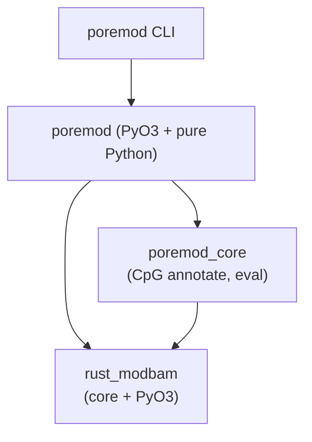

# poremod

A high-level base-modification analysis toolkit built on `rust_modbam`:
a unified command-line interface for the complete modbam workflow —
modification-type conversion (`convert`), MM/ML structural validation
(`validate`), mod-tagged re-alignment (`align`), per-site pileup with
optional CpG context annotation (`pileup`), per-read extraction
(`extract`), per-read accuracy evaluation (`evaluate`), and detection QC
histograms (`summarize`).

## Components

- `rust_modbam` -- per-read and per-site base-modification extraction
  from BAM (MM/ML tags), modbam modification-type conversion
  (`convert`), MM/ML structural validation (`validate`), and raw
  per-read tag access for re-alignment (`raw_reads`).

## Architecture



## Usage

### convert

Convert modification codes (drop / merge; `--drop-mode dist|norm|canonical`,
default `canonical`):

```bash
poremod convert --input in.bam --output out.bam --drop h
poremod convert --input in.bam --output out.bam --drop h --drop-mode dist
poremod convert --input in.bam --output out.bam --merge mh:m
poremod convert --input in.bam --output out.bam --drop h --json
```

Skip-mode rewrite: at most one of the two flags, each combinable with
`--drop` / `--merge`. `--explicit` writes `?` markers on every output
segment; `--compress-threshold` drops positions whose every code
probability is below the threshold. Without any of them the output is
unchanged apart from the folds.

```bash
poremod convert --input in.bam --output out.bam --explicit
poremod convert --input in.bam --output out.bam --compress-threshold 0.8
```

### validate

Validate MM/ML structure. Exit 0 for clean input or warnings only, 1 when
errors are found. By default the first 10000 records are checked; `--all`
scans the entire file.

```bash
poremod validate --input in.bam
poremod validate --input in.bam --json
poremod validate --input in.bam --all
```

### align

Build a modbam by re-aligning mod-tagged sequences against a reference.
Input may be FASTA, FASTQ, or modbam. Exit 2 on input errors, 1 on mappy
failures.

```bash
poremod align --input reads.fastq --reference ref.fa --output out.bam

# Tuning knobs mirror minimap2 CLI names
poremod align --input reads.fastq --reference ref.fa --output out.bam -k 17 -r 500,10000

# --eqx: =/X CIGAR operators instead of M
poremod align --input reads.fastq --reference ref.fa --output out.bam --eqx

# --secondary=no: suppress 0x100 (secondary) records; 0x800 stay
poremod align --input reads.fastq --reference ref.fa --output out.bam --secondary=no
```

### pileup

Per-site pileup with bedMethyl semantics. `--reference` is required for
`M`-input on a mapped read and for `--context cpg`; it is optional for
`=`/`X` input. An unmapped read is skipped because its calls cannot
become a site.

```bash
poremod pileup --input in.bam --output sites.tsv --reference ref.fa
poremod pileup --input in.bam --output sites.tsv --reference ref.fa --context cpg
poremod pileup --input in.bam --output sites.tsv --reference ref.fa --mod-code m
poremod pileup --input eqx.bam --output sites.tsv
```

### extract

Per-read modification calls as TSV. `--canonical-base` is required;
`--reference` is needed unless the CIGAR spells matches with `=`/`X`
(e.g. `align --eqx` output).

```bash
poremod extract --input in.bam --output calls.tsv --canonical-base C,A --reference ref.fa
poremod extract --input eqx.bam --output calls.tsv --canonical-base C

# Cap a large modbam to a random 2000 reads' worth of rows
poremod extract --input in.bam --output sample.tsv --canonical-base C --reference ref.fa \
  --sample-reads 2000
```

### evaluate

Score per-read modification calls against a five-column BED ground truth
(`chrom`, 0-based `start`, `end`, `canonical_base`, `expected_state`).
`--canonical-base` is required, and GT sites whose column 4 differs are
skipped.

```bash
poremod evaluate --input in.bam --truth gt.bed --canonical-base C
poremod evaluate --input in.bam --truth gt.bed --canonical-base C --json
```

### summarize

Per-mod-code QC histograms. By default 10000 eligible reads are sampled;
`--sample-reads 0` keeps all eligible reads, including unmapped ones.
`--reference` adds site-frequency output.

```bash
poremod summarize --input in.bam --output qc/
poremod summarize --input in.bam --output qc/ --reference ref.fa --figure
poremod summarize --bins qc/bins.tsv --output qc-replot/ --figure
```

### Read-side `--skip-mode`

`--skip-mode` decides how positions declared by the `MM` tag but carrying
no `ML` probability are treated. It is a read-side setting and moves the
numbers `pileup` reports; it is unrelated to `convert --explicit` and
`--compress-threshold`, which rewrite `MM`/`ML` in the output BAM.

- `implicit` (default) keeps them as inferred canonical calls with
  probability 0. They enter `n_canonical` and therefore
  `n_valid_cov = n_mod + n_canonical + n_other_mod` and the
  `percent_modified` denominator; a site whose only calls are inferred
  still produces a row, with `n_mod = 0`.
- `explicit` drops them. They no longer count towards `n_canonical` or
  `n_valid_cov`, and a site left without any call disappears from the
  output entirely.

`pileup`, `extract`, and `evaluate` share the same filter, so use one
value consistently when comparing runs. `extract` marks the affected rows
with its optional `inferred` column and omits them altogether under
`explicit`.

FASTA/FASTQ read IDs must carry modification information in SAMtag style:
`MM:Z:<mm string> ML:B:C,<comma-separated probabilities>`.

## Authors

连明 Ming Lian (lianming@genomics.cn)

## License and Usage Restrictions
**Research Use Only**  

This software is provided strictly for individual research purposes. Commercial use is strictly prohibited. This means:  
**Allowed:** Personal academic research, personal learning, and non-commercial experimentation.  
**Not Allowed:** Any form of commercial application, distribution, or use that generates revenue directly or indirectly. This includes, but is not limited to, integration into commercial products, offering this software as a service, or using it for commercial gain.  

For commercial licensing or permissions, please contact us.
